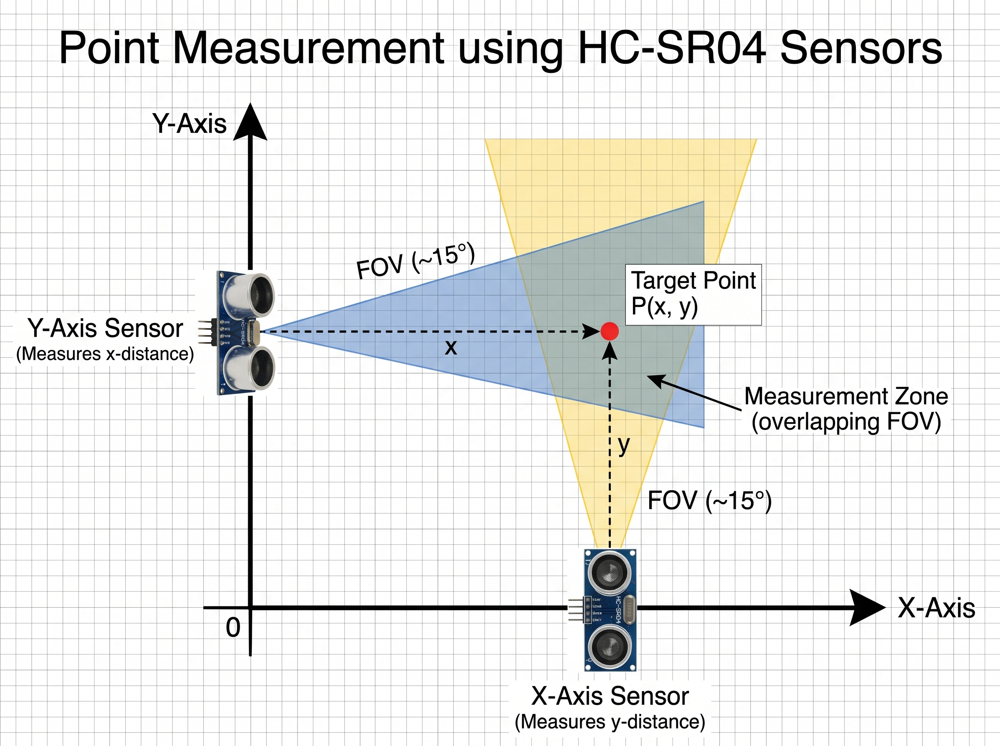

# Ultrasonic MNIST

Digits drawn in the air: two ultrasonic sensors on an ESP32 track a point, the computer draws its trail live in a web page, and a neural network trained from scratch names the digit.

## Documentation

| File | What it holds |
|---|---|
| [docs/plan.md](docs/plan.md) | Objectives, their status, and candidate ideas waiting for approval |
| [docs/apparatus.jpeg](docs/apparatus.jpeg) | Where the two sensors sit and point, and the zone where they measure the object |
| [plan-recipe.md](plan-recipe.md) | How the plan is built and kept up to date |
| [config.toml](config.toml) | Main parameters: area size, pencil and trail width, inference timeout, server, ESP32 port and calibration |
| [firmware/config.example.h](firmware/config.example.h) | ESP32 settings: WiFi, the computer's address, HC-SR04 pins and wiring, ping timing |

## Run

Needs Python 3.11+ and NumPy.

```sh
python3 train.py        # downloads MNIST to data/, trains the network, writes model.npz (~15 s)
python3 server.py       # then open http://127.0.0.1:8000
python3 test_server.py  # self-check of /predict and /config
```

The **Mouse** tab: draw a digit; it is read `timeout_s` seconds after the first point. The **ESP32** tab draws the sensor trail and shows the raw distances. The **Model** tab explains the network, its training results and the dataset.

The page only reads drawings. To teach it your own symbols, put 30+ images of each in `data/custom/<label>/` (any size, dark on light or light on dark), run `python3 train.py` (needs `pip install pillow`) and restart the server. The Model tab's last section has the details.

## ESP32

The firmware in `firmware/` reads two HC-SR04 sensors in turn on an ESP32-S3 and sends each pair of distances to `server.py` over WiFi as one UDP packet, ~17 per second.



The sensors sit at right angles. The one on the Y axis faces along x and measures the object's x; the one on the X axis faces along y and measures its y. The object is drawn only while it is inside both ~15° beams, a zone that is small near the sensors (a beam is ~50 mm wide at 200 mm), so a thin object such as a pen tip or a finger works best.

1. Wire each HC-SR04 to 5 V and GND, TRIG to its pin, and ECHO through a divider (1 kΩ to the pin, 2 kΩ from the pin to GND): ECHO is 5 V and the ESP32-S3 takes 3.3 V.
2. `cp firmware/config.example.h firmware/config.h` and fill in the WiFi network, this computer's address, and the pins. `config.h` is gitignored.
3. Flash it. Arduino IDE: open `firmware/firmware.ino`, board *ESP32S3 Dev Module*, *USB CDC On Boot: Enabled*. Or with arduino-cli:
   ```sh
   arduino-cli compile --upload -p /dev/ttyACM0 --fqbn esp32:esp32:esp32s3:CDCOnBoot=cdc firmware
   ```
   If the upload can't connect, hold BOOT, press RESET, release BOOT, and upload again.
4. Let the packets in if a firewall is on, e.g. `sudo ufw allow 8001/udp`, then start `server.py` and open the ESP32 tab. The serial monitor (115200 baud) shows the WiFi state and every reading too.

The drawing area is set in `[esp32]` in `config.toml` as a range of x and of y distances; read them off the ESP32 tab while you move the object to the zone's edges. The server smooths each sensor's readings before drawing: a median of the last 3 drops stray pings, then a low-pass filter evens out jitter (`median_of`, `low_pass`).

## Brief

The owner's description of the project, 2026-10-28:

> The main objective of this project is to create a handwritten number recognition app that uses two ultrasonic sensors to capture a point in 2D space, that point leaves a trail that draws the number in a web interface and a neural network trained from scratch is used to identify the number written in a 3 to 5 seconds trail. The two ultrasonic sensors can be plugged to a ESP32 board that sends data to the computer via WiFi and the computer shows the trail in realtime, then, after a fixed-configurable timeout, a neural network that has been trained in the MNIST dataset, or equivalent, is inferred to identify the number.
